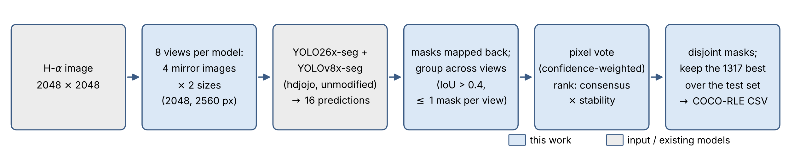

# Solar Filament Segmentation Challenge 2026: test-time augmentation and mask voting on two YOLO segmentation models
## Repository

| Path | Content |
|---|---|
| `filament_tta.py` | the method (prediction of the views, grouping, voting, ranking, selection, RLE output) |
| `reproduce_submission.ipynb` | the whole pipeline on the test set, step by step on one image first |
| `make_figures.py` | example segmentations for the report |
| `models/` | the two model files (Git LFS), their licence and training settings |
| `submission/` | the exact file submitted to Kaggle |
| `figures/` | pipeline diagram and example segmentations |
| `earlier_work/` | my own U-Net (public 0.38), not used in the final submission |

Final submission `submission/submission_scale_stable.csv`: **public PQ 0.44, private PQ 0.42.**



## Credits: the segmentation models are not mine

The two segmentation models were trained and published on Kaggle by **hdjojo**, under the Apache License 2.0:

- YOLO26x-seg, 2048 px: <https://www.kaggle.com/models/hdjojo/yolo26x-seg-solar-filament>
- YOLOv8x-seg, 2048 px: <https://www.kaggle.com/models/hdjojo/yolov8x-seg-solar-filament>

According to the author they were trained on the 707 competition training images only. They are stored unmodified in
`models/` (see `models/README.md` for their training settings, read from the checkpoint files). I did not have the
hardware to train extra-large YOLO models at 2048 px myself; my own models reached a public score of 0.38 at best
(`earlier_work/`).

**My contribution is the test-time processing** in `filament_tta.py`, which raised the public score from 0.40 (the two
models with their original inference notebook) to 0.44.

## Method

1. **16 predictions per image.** Each model predicts 8 views: the 4 mirror images (original, left-right, up-down, both)
   at 2048 px and the same 4 enlarged to 2560 px. Every mask is mapped back to the original image. Predictions down to
   confidence 0.15 are collected; masks under 30 px are ignored.
2. **Grouping.** The most confident unassigned mask starts a group; from each other view, the mask with the highest IoU
   above 0.4 joins it (at most one mask per view).
3. **Pixel voting.** A pixel belongs to the filament when it carries at least half of the group's total confidence.
4. **Ranking.** Consensus score = sum of the group's confidences / 16 (a filament found in every view with confidence c
   scores c). Stability = confidence-weighted mean IoU between the group's masks and the voted mask. Filaments are
   ranked by consensus x stability.
5. **Disjoint masks.** Filaments are painted in ranking order; overlapping pixels go to the better-ranked filament, and a
   filament that loses more than half of its area is dropped (the metric forbids overlaps).
6. **Selection.** The 1317 best filaments of the whole test set are kept. 1317 is the number the two models produce at
   confidence 0.5 with the original inference code, so the method changes which filaments are kept and their shapes,
   not how many.

Both flips were used when the models were trained (`flipud` and `fliplr` = 0.5), so the mirror views are familiar
images to them. Rotation in training was only ±10°: adding 90° rotated views made the score drop (table below).

## Results (Kaggle leaderboard, 180 test images, about half in each split)

| Submission | Public PQ | Private PQ |
|---|---|---|
| The two models, original inference notebook (confidence 0.5, mask NMS) | 0.40 | – |
| Same, images no longer skipped when only one model finds a filament | 0.40 | – |
| 4 mirror views x 2 models at 2048 px, voting, 1317 filaments | 0.44 | – |
| Same with 15 % more filaments (1515) | 0.43 | – |
| 4 rotations x mirror (8 views) x 2 models, 1317 or 1218 filaments | 0.41 | – |
| 4 mirror views at 2048 px + stability ranking | 0.43 | 0.42 |
| 4 mirror views at 2048 and 2560 px | 0.44 | 0.42 |
| **4 mirror views at 2048 and 2560 px + stability ranking (final)** | **0.44** | **0.42** |

Kaggle shows two decimals and each split has about 90 images, so differences of 0.01 are within noise. The clear
effects are the mirror-view voting (+0.04) and the 90° rotations (-0.03).

## Reproduce the submission

Requirements: a CUDA GPU (about 95 minutes on one NVIDIA T4, 31 s per image), Python 3.13, Git LFS.

```bash
git lfs install
git clone https://github.com/abder111/solar-filament-tta.git
cd solar-filament-tta
git lfs pull                      # the two model files (about 300 MB)
pip install -r requirements.txt
```

Put the competition test images (`*.jpeg`) in `data/test/test_images/`, or set `TEST_IMAGES_DIR` to their folder, then
run `reproduce_submission.ipynb` from the repository folder. It writes `outputs/submission_scale_stable.csv` and
compares it with the submitted file. On Kaggle, the competition data and the two hdjojo models attached as inputs are
found automatically.

GPU arithmetic is not bit-exact across hardware, so on another GPU a few masks may differ by some pixels.

## Figures

`make_figures.py` draws example segmentations from a submission file (no GPU needed):

```bash
python make_figures.py --test-dir data/test/test_images
```


## Licences

The code in this repository is under the GNU AGPL-3.0 (`LICENSE`), because it uses Ultralytics, which is AGPL-3.0.
The model files in `models/` are by hdjojo, under the Apache License 2.0 (`models/LICENSE-Apache-2.0.txt`).
